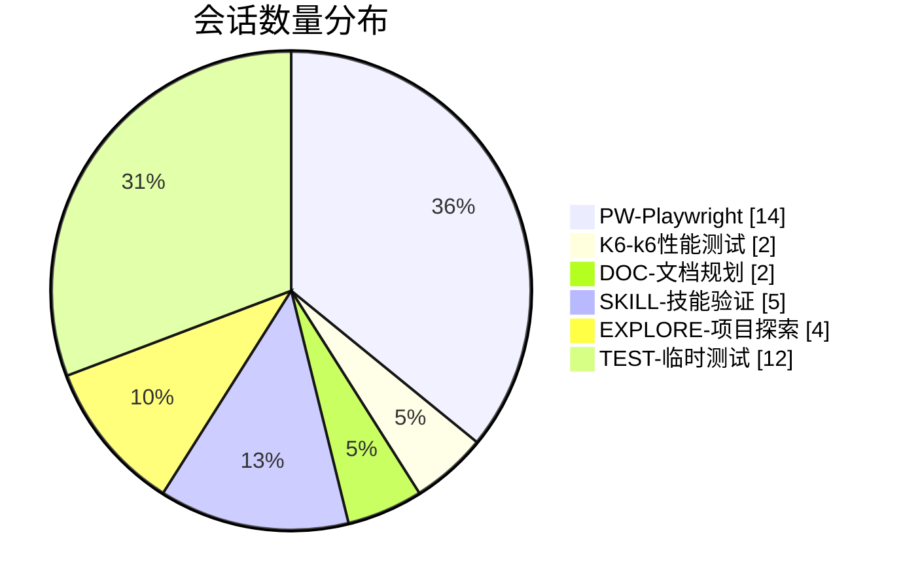

# Copilot 会话归档 — 分类重命名方案

> 生成时间：2026-11-09  
> 原始会话数：39  
> 命名规范：`[类别前缀]-[项目名]-[描述] [Action标记]`

---

## 一、命名规范

| 要素 | 规则 | 示例 |
|------|------|------|
| **类别前缀** | `PW-` / `K6-` / `DOC-` / `SKILL-` / `EXPLORE-` / `TEST-` | `PW-DOTS-KMServer` |
| **项目名** | 中等长度（如 DOTS-KMServer） | `DOTS-KMServer` |
| **描述** | 用例编号 + 功能简述 | `T424-UndoRedo` |
| **Action 标记** | `[DONE]` / `[ACTION]` / `[WIP]` / `[INFO]` | `[DONE]` |

### Action 标记说明

| 标记 | 含义 |
|------|------|
| `[DONE]` | 已完成，无需后续操作 |
| `[ACTION]` | 需要你采取行动/决策 |
| `[WIP]` | 进行中 |
| `[INFO]` | 纯信息获取，无后续 |

---

## 二、按类别分组汇总

### 🔵 PW — Playwright 自动化测试（14个）

检查 Playwright 脚本是否符合测试用例，使用 `/testcase-step-alignment` 技能进行 Review。

| # | 建议名称 | 涉及用例 | 日期 |
|---|---------|---------|------|
| 1 | `PW-DOTS-KMServer-T717-RightsMgmt-NoName [DONE]` | T717 Rights management: create a new user role with no name | 2026-09-10 |
| 2 | `PW-DOTS-KMServer-T424-UndoRedo-Review [DONE]` | T424 testUndoRedoAfterSavingChanges (jobList/undoRedo) | 2026-08-24 |
| 3 | `PW-DOTS-KMServer-T275-HotFolder-Disable [DONE]` | T275 Hot folders: Disable hot folder service when web page is active | 2026-08-21 |
| 4 | `PW-DOTS-KMServer-T1232-FTPConnection-Test [DONE]` | T1232 Edit and Test FTP Connection | 2026-08-21 |
| 5 | `PW-DOTS-KMServer-T674-WorkSteps-Enable [DONE]` | T674 Enable work steps and status | 2026-08-20 |
| 6 | `PW-DOTS-KMServer-T243-CustomerAccount-HotFolder [DONE]` | T243 Add new Customer account via Hot folder config | 2026-08-19 |
| 7 | `PW-DOTS-KMServer-T243-CustomerAccount-Address [DONE]` | T243 Addresses tab opened | 2026-08-19 |
| 8 | `PW-DOTS-KMServer-T192-PrintProduct-Imposition [DONE]` | T192 Imposition and Double-sided printing | 2026-08-18 |

> ⚠️ T424 有 4 个重复会话（不同轮次），T243 有 3 个重复会话。建议合并保留最新的一个。

---

### 🟢 K6 — k6 性能测试（2个）

JMeter 脚本迁移到 k6，对比核心功能的性能差异。

| # | 建议名称 | 内容 | 日期 |
|---|---------|------|------|
| 1 | `K6-DOTS-Tests-WebCore-Migration [WIP]` | JMeter → k6 迁移，web 系统核心 case，6 个 case 已作成 | 2026-08-31 |

---

### 🟡 DOC — 文档/规划（2个）

自动化项目推进相关的文档和规划。

| # | 建议名称 | 内容 | 日期 |
|---|---------|------|------|
| 1 | `DOC-AutoProgress-FY26Plan [ACTION]` | 自动化项目推进进度表补填（缺 4 次记录） | 2026-08-31 |
| 2 | `DOC-AutoBlueprint-V1.5-Refine [ACTION]` | 自动化平台统一蓝图 V1.5 + BSDD FY26 方针完善 | 2026-08-18 |

---

### 🟣 SKILL — 技能验证（5个）

验证 testcase-step-alignment 技能的可见性和可用性。

| # | 建议名称 | 内容 | 日期 |
|---|---------|------|------|
| 1 | `SKILL-StepAlignment-Verify-Visibility [INFO]` | 确认技能是否可见 | 2026-09-10 |

---

### 🟠 EXPLORE — 项目探索（4个）

探索项目路径、脚本存在性等基础确认。

| # | 建议名称 | 内容 | 日期 |
|---|---------|------|------|
| 1 | `EXPLORE-PW-T424-ScriptExists [INFO]` | 确认 testUndoRedoAfterSavingChangesT424.spec.ts 是否存在 | 2026-08-24 |
| 2 | `EXPLORE-PW-ProjectPath-Verify [INFO]` | 确认项目路径 D:\Flux\dots-tests\playwright | 2026-08-24 |

---

### ⚪ TEST — 临时测试（12+个）

早期测试、模型确认、空会话等。

| # | 建议名称 | 内容 | 日期 |
|---|---------|------|------|
| 1 | `TEST-General-Sanity [INFO]` | 简单测试 | 2026-09-10 |
| 2 | `TEST-SkillInvocation-Verify [INFO]` | 确认能否调用自定义技能 | 2026-07-29 |
| 3 | `TEST-ModelCheck-Identity [INFO]` | 确认当前使用的模型 | 2026-07-29 |
| 4-12 | `TEST-General-Empty [INFO]` | NULL 摘要的空会话（共 7 个） | 2026-07-29 ~ 2026-08-24 |

---

## 三、统计总览

| 类别 | 数量 | 占比 |
|------|------|------|
| PW-Playwright | 14 | 36% |
| TEST-临时测试 | 12 | 31% |
| SKILL-技能验证 | 5 | 13% |
| EXPLORE-项目探索 | 4 | 10% |
| K6-k6性能测试 | 2 | 5% |
| DOC-文档规划 | 2 | 5% |
| **合计** | **39** | **100%** |

---

## 四、需要 Action 的项目

以下会话标记为 `[ACTION]`，需要你跟进处理：

| 序号 | 建议名称 | 待办事项 |
|------|---------|---------|
| 1 | `DOC-AutoProgress-FY26Plan [ACTION]` | 补填自动化项目推进进度表（缺 4 次记录） |
| 2 | `DOC-AutoBlueprint-V1.5-Refine [ACTION]` | 完善自动化平台统一蓝图 V1.5，融入 BSDD FY26 方针数据 |

---

## 五、建议清理项

以下类型的会话建议考虑清理或归档：

| 类型 | 数量 | 建议 |
|------|------|------|
| NULL 摘要空会话 | 7 | 可删除，无实际内容 |
| 重复会话（T424 x4, T243 x3） | 7 | 保留最新一次，其余可删除 |
| 早期测试会话（2026-07） | 5 | 可归档或删除 |

---

## 六、重要说明

**Copilot 本地会话的名称无法通过工具直接修改。** 本文件作为归档参考，记录了所有会话的分类和重命名建议。

如需进一步整理，建议：
1. 在 VS Code 中手动重命名重要会话
2. 将本文件保存为项目文档
3. 未来新会话遵循此命名规范
